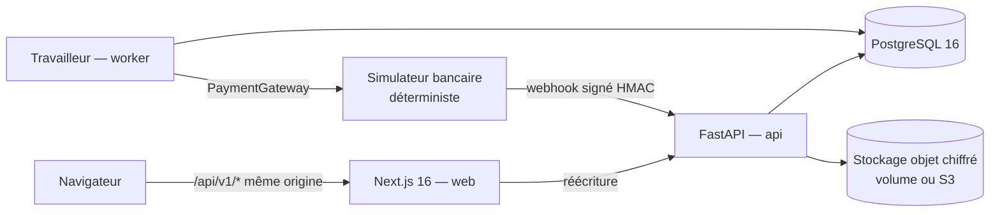

# Architecture

## Vue d'ensemble

Monolithe modulaire : un seul déploiement backend (API + travailleur partageant le même code), des modules aux
frontières explicites communiquant par appels de service. Les tables `sim_*` représentent l'état d'un système
**externe** fictif et ne sont lues qu'à travers les adaptateurs.

## Modules (`backend/horizon/modules/`)

| Module | Responsabilité |
|---|---|
| `identity` | Utilisateurs, sessions, défis MFA, réauthentification, `IdentityProvider` |
| `organizations` | Groupe, entités, mandats (rôles + périmètre + plafonds), délégations, politiques d'approbation, `permissions.py` |
| `accounts` | Comptes simulés/externes, relevés externes, soldes expliqués, consolidation |
| `ledger` | Plan de comptes, journaux, écritures équilibrées, contrepassations, réservations |
| `beneficiaries` | Bénéficiaires versionnés, revue, suspension |
| `payments` | Lots, paiements, cycle de vie (`state.py`), préparation (`service.py`), exécution et événements (`execution.py`) |
| `approvals` | Décisions, quorum, autorité (mandats/délégations), invalidation |
| `forecasting` | Encaissements attendus, hypothèses récurrentes, scénarios, calcul et historisation |
| `fx` | Taux datés, conversions identifiées, devis indicatifs / exécutables simulés |
| `financing` | Contrats, utilisations, échéances, simulations, demandes |
| `documents` | Stockage objet protégé, liens temporaires |
| `trade` | Dossiers de commerce international (documentaire) |
| `reconciliation` | Rapprochement relevé ↔ registre, cas |
| `decisions` | Centre de décisions calculé, accusés de réception |
| `audit` | Journal chaîné |
| `integrations` | Contrats d'adaptateurs, simulateur bancaire, fournisseur de taux |
| `jobs` | File de tâches PostgreSQL |
| `reports` | Export rapport + piste d'audit |
| `overview` | Indicateurs du tableau de bord et leurs justifications |

`core/` : configuration, base de données, horloge injectable (tests d'expiration), montants, erreurs,
pagination, cryptographie (scrypt, TOTP, Fernet, HMAC), IBAN, expurgation, contexte de requête.
`api/` : routeurs FastAPI et schémas Pydantic (`extra="forbid"`).

## Adaptateurs d'intégration

| Contrat | Implémentation fournie |
|---|---|
| `PaymentGateway` (`submit`, `find`) | `SimulatedBank` |
| `StatementProvider` (`statement`) | `SimulatedBank` (lignes de relevé : règlements, retours, encaissements, frais) |
| `RateProvider` | `DeterministicRateProvider` |
| `NotificationSender` | `LogNotificationSender` (journalise, n'envoie rien) |
| `IdentityProvider` | `LocalDemoIdentityProvider` |
| `ObjectStorage` (import de documents) | `EncryptedFilesystemStorage`, `S3Storage` |

ISO 20022 : **non implémenté**. Aucun message n'est produit ; aucune compatibilité SEPA ou SWIFT n'est revendiquée.

## Base de données

* Migrations Alembic : `0001` (schéma, 45 tables), `0002` (garde-fous : immuabilité du registre et de l'audit,
  équilibre différé par devise, immuabilité des coordonnées de bénéficiaire, séquences).
* Index uniques partiels : une réservation active par paiement, une approbation valide par personne et version.
* Montants `BIGINT` en unités mineures ; taux `NUMERIC(20,10)`.

## Dépendances (versions vérifiées le 28/11/2026)

Versions relevées sur les registres officiels (PyPI, npm) puis exercées par la suite de tests :

| Composant | Version | Remarque |
|---|---|---|
| Python | 3.13 | |
| FastAPI | 0.165.0 | Starlette 1.10.0 ; avertissement de dépréciation de `httpx` dans `TestClient` (sans effet) |
| SQLAlchemy | 2.1.9 | API 2.0 typée (`Mapped`) |
| Alembic | 1.20.1 | |
| psycopg | 3.3.9 | |
| Pydantic | 2.13.5 | |
| cryptography | 50.0.2 | Fernet |
| minio (SDK) | 7.2.20 | adaptateur S3 |
| pytest | 9.1.1 | |
| moto | 5.2.6 | émulateur S3 (tests) |
| PostgreSQL | 16 | triggers de contrainte différés, `SKIP LOCKED`, `DROP DATABASE … WITH (FORCE)` |
| Next.js | 16.4.6 | App Router, Turbopack ; pas de middleware |
| React | 19.3.1 | |
| TypeScript | 5.9.3 | |
| @playwright/test | 1.63.0 | aligné sur le navigateur préinstallé |

Liste complète figée : `backend/requirements.lock`, `frontend/package-lock.json`.

## Choix et compromis

* **File de tâches PostgreSQL** plutôt qu'un courtier : transactionnelle avec les données métier (mise en file
  atomique avec l'approbation), suffisante pour le volume visé ; remplaçable plus tard.
* **Sessions opaques** plutôt que JWT : révocables, rien de sensible côté client.
* **Simulateur dans le même processus/base** pour la reproductibilité ; il utilise ses propres transactions pour
  se comporter comme un système externe (un ordre « enregistré puis réponse perdue » survit à l'échec de l'appelant).
* **Prévision déterministe** : explicable ligne par ligne ; la fourchette est une enveloppe de scénarios assumée.
