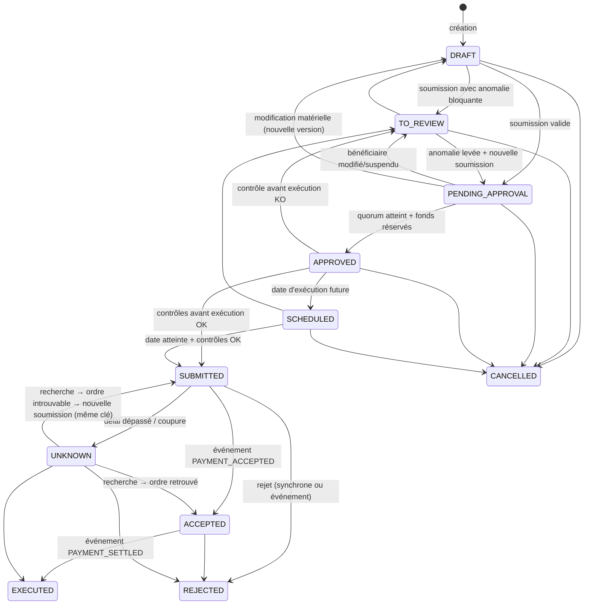

# Paiements, approbations et exécution simulée

> ENVIRONNEMENT DE DÉMONSTRATION — aucun ordre n'est transmis à une banque réelle. Le « système destinataire »
> est le simulateur déterministe `horizon/modules/integrations/bank_simulator.py`.

## 1. Objets

| Objet | Rôle |
|---|---|
| `PaymentBatch` (lot) | Unité d'approbation. Un **virement unitaire** est un lot `SINGLE` d'un paiement ; les autres types sont `SUPPLIER_BATCH`, `CSV_IMPORT`, `FINANCING`. Porte une `version` incrémentée à chaque modification matérielle. |
| `Payment` | Ligne individuelle : son propre statut, sa `submission_key` (clé d'idempotence transmise au destinataire), son `end_to_end_id`, la **version figée du bénéficiaire** (`beneficiary_version_id`). |
| `Approval` | Décision d'un approbateur sur **(lot, version)**, avec expiration et horodatage de réauthentification. |
| `Reservation` | Montant réservé sur le compte débité entre l'approbation finale et le règlement (ou la libération). |
| `PaymentEvent` | Historique horodaté de chaque transition (acteur, source, motif, version). |
| `BankEventInbox` | Boîte de réception idempotente des événements du destinataire (`event_id` unique). |

## 2. Cycle de vie d'un paiement

| Statut (code) | Libellé affiché | Transitions autorisées |
|---|---|---|
| `DRAFT` | Brouillon | TO_REVIEW, PENDING_APPROVAL, CANCELLED |
| `TO_REVIEW` | À vérifier | DRAFT, PENDING_APPROVAL, CANCELLED |
| `PENDING_APPROVAL` | En attente d'approbation | APPROVED, TO_REVIEW, DRAFT, CANCELLED |
| `APPROVED` | Approuvé | SCHEDULED, SUBMITTED, TO_REVIEW, PENDING_APPROVAL, DRAFT, CANCELLED |
| `SCHEDULED` | Planifié | SUBMITTED, TO_REVIEW, PENDING_APPROVAL, DRAFT, CANCELLED |
| `SUBMITTED` | Soumis | ACCEPTED, EXECUTED, REJECTED, UNKNOWN |
| `ACCEPTED` | Accepté par le système destinataire | EXECUTED, REJECTED |
| `EXECUTED` | Exécuté selon confirmation | — (les retours de fonds sont des événements liés) |
| `REJECTED` | Rejeté | — (traitement du rejet tracé séparément) |
| `CANCELLED` | Annulé | — |
| `UNKNOWN` | Résultat inconnu | SUBMITTED, ACCEPTED, EXECUTED, REJECTED |

La table est la source de vérité (`horizon/modules/payments/state.py`), exposée par `GET /v1/payment-lifecycle`.
Toute transition hors table lève `409 INVALID_TRANSITION`. Le lot suit un cycle parallèle
(`PROCESSING` puis `COMPLETED` lorsque tous ses paiements sont dans un état final ; `REJECTED` = refusé à l'approbation).

### Réception technique ≠ acceptation ≠ exécution

* `technical_ack_at` : le destinataire a répondu HTTP 202 à la soumission. Le paiement **reste `SUBMITTED`** ;
  l'historique affiche « Réception technique ». Aucun débit, la réservation demeure.
* `ACCEPTED` : événement métier `PAYMENT_ACCEPTED` du destinataire.
* `EXECUTED` : uniquement sur `PAYMENT_SETTLED` (confirmation de règlement). C'est **à ce moment seulement**
  que la réservation est consommée et l'écriture comptable passée.

### Lots : résultats individuels

Chaque paiement d'un lot avance indépendamment. Un lot peut se terminer avec `{"EXECUTED": 6, "REJECTED": 1}` ;
le motif de lot l'indique (« 6 exécuté(s), 1 rejeté(s) ») et chaque ligne conserve son code de rejet
(`AC04 — Compte du bénéficiaire clôturé`, …).

## 3. Préparation et validation

* `POST /v1/payment-batches` (en-tête `Idempotency-Key` recommandé) : même clé + même contenu → même lot (HTTP 200,
  `Idempotent-Replayed: true`) ; même clé + contenu différent → `409 IDEMPOTENCY_KEY_REUSED`.
* Compte débité : uniquement un compte **SIMULÉ** ouvert (`422 ACCOUNT_READ_ONLY` pour un compte externe).
* Bénéficiaire : de la même entité que le compte, non suspendu/rejeté ; la **version approuvée** est figée.
* `POST …/submit-for-approval` : contrôles (bénéficiaire approuvé, modification en revue, date, compte) ; les
  anomalies bloquantes mènent à `TO_REVIEW`, l'insuffisance de fonds est un **avertissement** à ce stade
  (revérifiée à l'approbation finale et avant exécution). La règle d'approbation applicable est figée.
* Import CSV (`iban;montant;libelle`, séparateur `;` ou `,`) : tout ou rien, rapport ligne par ligne,
  aucune création implicite de bénéficiaire.

## 4. Approbations

Contrôles appliqués côté serveur à chaque décision (`approvals/service.py::decide`) :

1. Lot à l'état `PENDING_APPROVAL` et **version soumise = version courante** (`409 VERSION_MISMATCH` sinon).
2. **Réauthentification** MFA de moins de 5 min (`401 STEP_UP_REQUIRED`).
3. **Séparation des tâches** : ni le créateur du lot ni l'auteur d'une ligne (`403 SEGREGATION_OF_DUTIES`).
4. **Autorité** : mandat `APPROVER` couvrant l'entité *et* le compte (restriction par compte), plafond ≥ montant
   (converti au taux daté si besoin), ou **délégation** active plafonnée et adossée au droit du délégant
   (`403 APPROVAL_LIMIT_EXCEEDED`). Le rôle `ADMIN` n'inclut jamais `payment.approve`.
5. Une seule décision valide par personne et par version (index unique partiel `uq_approvals_valid_per_user`).
6. Quorum : nombre d'**approbateurs distincts** dont l'approbation est non invalidée, non expirée, sur la version
   courante ≥ `required_approvals` de la règle applicable (portée la plus spécifique : compte > entité > groupe,
   puis seuil le plus élevé ≤ montant).

Seed : groupe ≥ 0 € → 1 approbation ; ≥ 50 000 € → 2 ; compte principal France ≥ 2 M€ → 3. Validité : 72 h.

**Concurrence** : la décision verrouille le lot (`SELECT … FOR UPDATE`). Deux approbations simultanées sont
sérialisées ; la seconde voit la première, le quorum est évalué une fois, les fonds sont réservés une fois et
une seule tâche `execute_batch` est enfilée (clé de déduplication). Testé par
`test_concurrent_approvals_finalize_exactly_once` et `test_concurrent_double_click_same_approver`.

**Approbation finale** : verrou du compte, calcul du disponible ; si insuffisant → `409 INSUFFICIENT_FUNDS` et
**l'approbation n'est pas enregistrée** (transaction annulée).

**Invalidations** : modification matérielle du lot (montant, ligne, date) → nouvelle version, approbations
invalidées, réservations libérées, retour en brouillon. Modification matérielle ou suspension d'un bénéficiaire →
lots concernés repassés « À vérifier », approbations invalidées, réservations libérées.

## 5. Exécution (travailleur)

`execute_batch` (idempotent) revérifie **avant toute soumission** :

* version = version approuvée ;
* approbations toujours valides : non invalidées, non expirées *au moment du quorum*, et approbateurs **disposant
  toujours de leur mandat** (un droit révoqué invalide l'approbation) ;
* bénéficiaires actifs et coordonnées matérielles identiques à la version approuvée ;
* réservation active du bon montant ; compte ouvert.

En cas d'échec : retour « À vérifier », réservations libérées, audit `payment_batch.execution_blocked`.

Puis chaque paiement passe `SUBMITTED` (transaction validée) et une tâche `submit_payment` est enfilée
(clé `submit_payment:<id>:<tentative>`). La soumission transmet la `submission_key` ; le destinataire est
idempotent sur cette clé.

## 6. Événements, doublons et absence de double débit

Deux barrières indépendantes :

1. `bank_event_inbox.event_id` unique : un événement redélivré est compté (`duplicate_deliveries`) et ignoré.
2. L'écriture d'exécution a pour clé `payment-execution:<payment_id>` (unique) : même un « nouvel » événement
   de règlement pour un paiement déjà exécuté ne produit aucune écriture (`IGNORED_ALREADY_FINAL`).

Les webhooks du simulateur sont signés HMAC-SHA256 (`X-Horizon-Signature`) ; signature invalide → `401`.

## 7. Résultat inconnu

Déclencheurs : délai dépassé à la soumission, ou soumission interrompue (paiement `SUBMITTED` sans réception
technique depuis 5 min — tâche `recover_stale_submissions`, reprise après arrêt du travailleur).

1. Paiement → `UNKNOWN`, cas de rapprochement `UNKNOWN_PAYMENT_RESULT` ouvert, visible au centre de décisions.
2. Tâche `reconcile_unknown` : **recherche de l'ordre** chez le destinataire par `submission_key`.
   * Trouvé → statut aligné (soumis/accepté/exécuté/rejeté), **aucune nouvelle soumission**.
   * Introuvable → nouvelle soumission **avec la même clé** (`submission_attempts` + 1).
3. Le cas est clos automatiquement avec la justification (cause traitée).

Vérifié en démonstration et en test : exactement **un** ordre par clé chez le destinataire.

## 8. Annulation, rejet, retour de fonds

* Annulation : possible jusqu'à `SCHEDULED` inclus (réservations libérées). Après transmission :
  `409 NOT_CANCELLABLE` — un rappel de fonds serait nécessaire (fonction reportée).
* Rejet : réservation libérée, aucun débit ; l'élément « Paiement rejeté » reste au centre de décisions jusqu'à
  un **traitement motivé** (`POST /v1/payments/{id}/rejection-resolution`). Un simple accusé de réception ne
  suffit pas.
* Retour de fonds : événement `PAYMENT_RETURNED` → écriture `RET` liée (Dr banque / Cr tiers), `returned_minor`
  mis à jour ; le paiement reste « Exécuté » et l'historique affiche « Retour de fonds ».

## 9. Règles déterministes du simulateur

| Condition | Résultat |
|---|---|
| IBAN créancier se terminant par `0404` | Rejet `AC04` (compte clôturé) |
| Montant > 10 000 000 | Rejet `AM02` |
| IBAN dont les deux premiers caractères ne sont pas des lettres | Rejet synchrone `AC01` |
| Panne injectée `TIMEOUT_AFTER_RECORD` | Ordre enregistré, réponse perdue |
| Panne injectée `TIMEOUT_BEFORE_RECORD` | Rien d'enregistré, réponse perdue |
| Sinon | `ACCEPTED` puis `SETTLED` + ligne de relevé |
